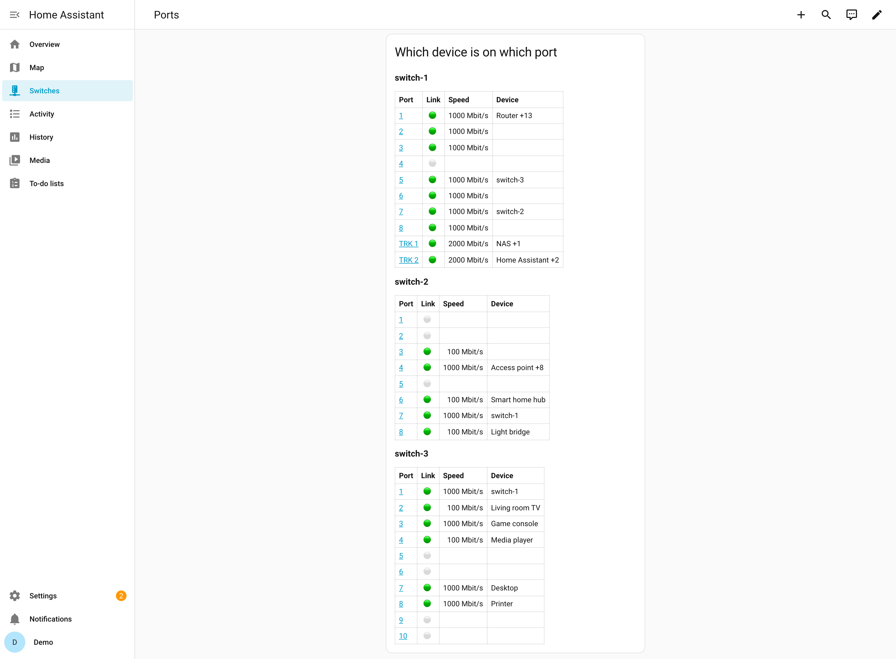
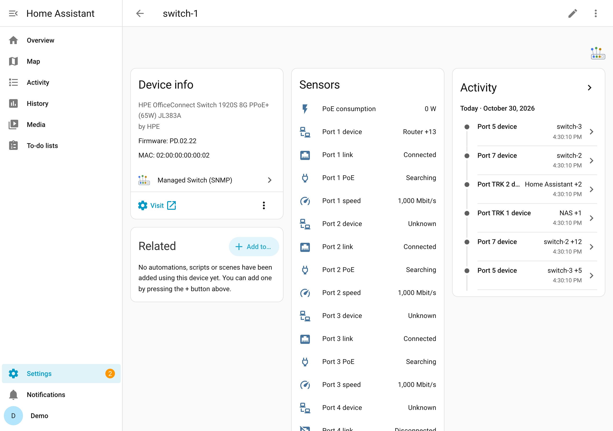
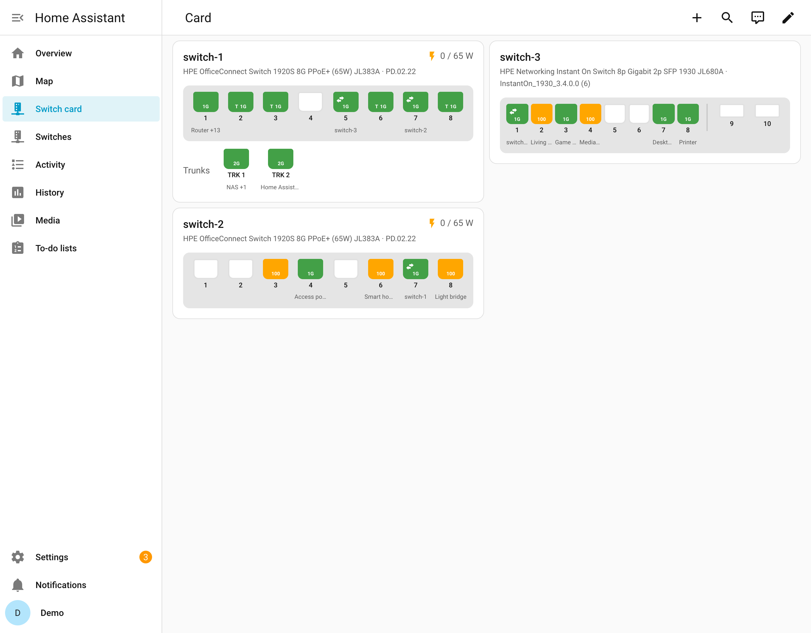

# Managed Switch (SNMP) for Home Assistant

| HACS | Release | CI | License |
| ---- | ------- | -- | ------- |
| [](https://hacs.xyz/docs/faq/custom_repositories/) | [](https://github.com/eizedev/ha-managed-switch/releases) | [](https://github.com/eizedev/ha-managed-switch/actions/workflows/ci.yml) | [](https://github.com/eizedev/ha-managed-switch/blob/main/LICENSE) |

<picture>
  <source media="(prefers-color-scheme: dark)" srcset="https://raw.githubusercontent.com/eizedev/ha-managed-switch/main/assets/header-dark.svg">
  
</picture>

Shows your **managed network switches** in Home Assistant over SNMP: every port with link,
speed, traffic and PoE, and **which device is connected to which port**, across all your
switches, named after the devices Home Assistant already knows. Events tell you when an uplink
or trunk goes down, a port comes back slower, a switch restarts or a new device appears, and a
dashboard card draws each switch's front panel. Read only: it never changes a setting.

[](https://my.home-assistant.io/redirect/hacs_repository/?owner=eizedev&repository=ha-managed-switch&category=integration)
[](https://my.home-assistant.io/redirect/config_flow_start/?domain=managed_switch)

**Documentation: [ha-managed-switch.eize.dev](https://ha-managed-switch.eize.dev/)**

<p>
  
  
</p>

## What you get

- One device per switch: last restart, PoE budget and consumption, spanning tree changes,
  temperatures where the switch reports them.
- Per port (and per trunk): link, speed, the connected device (an LLDP neighbour such as
  another switch, or the devices learned on the port, named from Home Assistant's device
  registry) and how many devices are on it, PoE status, and on request received and sent
  traffic and errors.
- One events entity per switch with a ready blueprint for notifications.
- A dashboard card with the switch's front panel, included (see below).
- SNMPv3 (recommended) or v2c, standard MIBs, plus the HPE 1930's own sensor table:
  vendor-neutral. Tested on HPE OfficeConnect 1920S and HPE Instant On 1930; other managed
  switches with SNMP are expected to work.

## Switch card

The integration comes with a card that draws a switch like its own web interface: every port
coloured by link and speed, uplinks to other switches, trunks, PoE delivering power, and the
device on each port. There is nothing to install: edit a dashboard, *Add card*, **Managed
Switch**, and choose the switch. Details: [Switch card](https://ha-managed-switch.eize.dev/card/).



## Install

In HACS, add this repository as a custom repository of the type *Integration* (or use the button
above), install **Managed Switch (SNMP)** and restart Home Assistant:

```text
https://github.com/eizedev/ha-managed-switch
```

Then add the integration once per switch. Requires Home Assistant 2026.10.3 or newer. Details:
[Installation](https://ha-managed-switch.eize.dev/installation/).

## Blueprints

Ready automations for notifications; import one, then create an automation per switch. Details:
[Events](https://ha-managed-switch.eize.dev/events/).

| Blueprint | Notifies when | Import |
| --- | --- | --- |
| Managed switch events | an uplink or trunk goes down, a port comes back slower, the switch restarts, or a new device is plugged in directly (also behind other devices if you turn that on) | [](https://my.home-assistant.io/redirect/blueprint_import/?blueprint_url=https%3A%2F%2Fgithub.com%2Feizedev%2Fha-managed-switch%2Fblob%2Fmain%2Fblueprints%2Fautomation%2Fmanaged_switch%2Fnotify_switch_events.yaml) |

## Documentation

- [Installation](https://ha-managed-switch.eize.dev/installation/) and [Configuration](https://ha-managed-switch.eize.dev/configuration/): SNMP access on the switch, setup, options
- [Entities](https://ha-managed-switch.eize.dev/entities/) and [Events](https://ha-managed-switch.eize.dev/events/): what each one means, the blueprint
- [Dashboard](https://ha-managed-switch.eize.dev/dashboard/): a port overview to paste
- [Ideas and automations](https://ha-managed-switch.eize.dev/ideas/): link lost, slow port, PoE, busy port
- [Switch card](https://ha-managed-switch.eize.dev/card/): colours, options, your own layout, what the card reads
- [Troubleshooting](https://ha-managed-switch.eize.dev/troubleshooting/)

The SNMP part is the library [aiosnmpswitch](https://aiosnmpswitch.eize.dev/).

## Roadmap

Planned work is in the [roadmap issues](https://github.com/eizedev/ha-managed-switch/issues?q=is%3Aissue+is%3Aopen+label%3Aroadmap):
PoE power per port, fans and power supplies ([#4](https://github.com/eizedev/ha-managed-switch/issues/4),
[#5](https://github.com/eizedev/ha-managed-switch/issues/5)).

## Contributing

Reports with your switch model help most. See [CONTRIBUTING.md](https://github.com/eizedev/ha-managed-switch/blob/main/CONTRIBUTING.md);
for security issues [SECURITY.md](https://github.com/eizedev/ha-managed-switch/blob/main/SECURITY.md).

## License

[MIT](https://github.com/eizedev/ha-managed-switch/blob/main/LICENSE). Provided "as is", without warranty of any kind. The icon and header images are
CC BY 4.0; their source is in [eizedev/brand](https://github.com/eizedev/brand).
