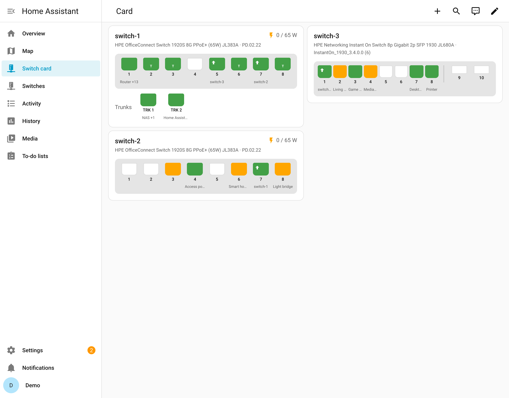

# Switch card

[managed-switch-card](https://github.com/eizedev/managed-switch-card) draws a switch like its own
web interface: every port coloured by link and speed, uplinks to other switches, trunk members,
PoE delivering power, and the device on each port.



## Install

The card needs this integration in version 0.2.0 or newer.

[](https://my.home-assistant.io/redirect/hacs_repository/?owner=eizedev&repository=managed-switch-card&category=plugin)

Or in HACS: the three dots, *Custom repositories*, add this URL with the type *Dashboard*:

```text
https://github.com/eizedev/managed-switch-card
```

Install **Managed Switch Card** and reload the browser. Then edit a dashboard, *Add card*,
**Managed Switch**, and choose the switch. One card per switch.

## What it shows

| On a port | Meaning |
| --- | --- |
| green | link at 1 Gbit/s or more |
| orange | link at 100 Mbit/s |
| red | link at 10 Mbit/s |
| white | no link |
| grey | unknown (the switch did not answer) |
| arrow | link to another of your switches |
| flash | PoE delivering power |
| T | member of a trunk; the trunks are listed below the ports |

Under each port is the device connected to it, as the port's device sensor names it
([Entities](entities.md)). Hover over a port, or tap and hold, for all devices on it; a click opens
the device sensor. The header shows the switch's PoE consumption and budget.

## Options

```yaml
type: custom:managed-switch-card
device_id: 0123456789abcdef0123456789abcdef  # the switch, chosen in the card's dialog
title: Hallway                               # optional, else the switch's name
show_names: true                             # device names under the ports (default)
show_rates: false                            # data rates (↓ in, ↑ out, Mbit/s); turn on the
                                             # ports' "received" and "sent" sensors first
layout:                                      # optional: your own front panel, by port name
  rows:
    - ["1", "3", "5", "7"]
    - ["2", "4", "6", "8"]
  sfp: ["9", "10"]
```

The card knows the front panel of the tested models (HPE OfficeConnect 1920S 8G, HPE Instant On
1930 8G 2SFP). Other switches get their ports in one row, or odd numbers above even ones beyond
twelve; `layout` draws them as your switch looks. A layout for your model is welcome in the
[card's repository](https://github.com/eizedev/managed-switch-card/blob/main/CONTRIBUTING.md).
