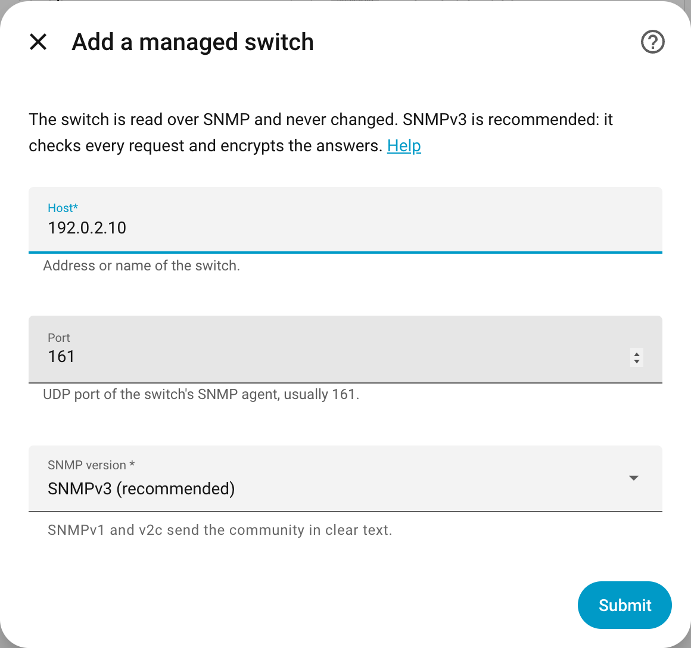
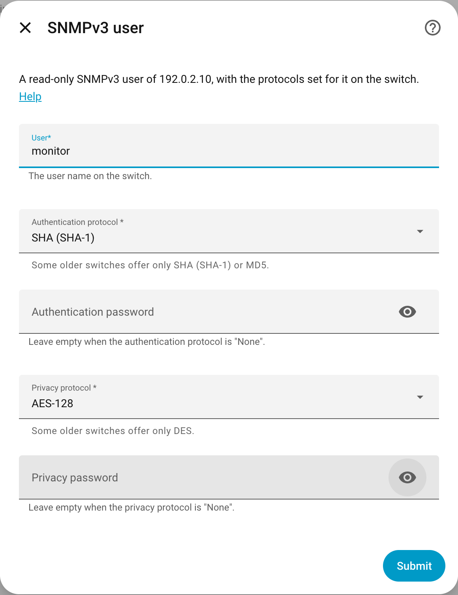

# Configuration

## SNMP access

The integration needs **read-only** SNMP access to each switch. Create it on the switch first.

**SNMPv3 (recommended)** checks every request and encrypts the answers:

1. A view that includes the tree `1.3.6.1` (and `1.0.8802` for LLDP, `1.2.840` for trunks, if
   the switch asks for them separately).
2. A group with security level *authPriv*, that view for reading, nothing for writing.
3. A user in that group, with the strongest authentication and privacy protocols the switch
   offers, and two different, long passwords. Some older switches offer only SHA (SHA-1) and
   DES; that is weak, but fine for reading in your own network.

**SNMPv2c** sends the community in clear text, and anyone who knows it can read the switch. If
you use it, choose a community other than `public` and, if the switch can, allow only Home
Assistant's address.

Where these settings are differs per switch and firmware; look for *SNMP* in the switch's web
interface and its manual.

**What the read access must include.** A view of the whole tree `1` is simplest. A narrower view
needs these MIBs, each for part of the integration:

| MIB | Subtree | Without it |
| --- | --- | --- |
| SNMPv2-MIB, IF-MIB | `1.3.6.1.2.1.1`, `1.3.6.1.2.1.2`, `1.3.6.1.2.1.31` | nothing works |
| BRIDGE-MIB, Q-BRIDGE-MIB | `1.3.6.1.2.1.17` | no devices on ports, no spanning tree |
| LLDP-MIB | `1.0.8802.1.1.2` | no links between switches, no `uplink_down` |
| IEEE8023-LAG-MIB | `1.2.840.10006.300.43` | no trunks |
| POWER-ETHERNET-MIB | `1.3.6.1.2.1.105` | no PoE entities |
| IP-MIB | `1.3.6.1.2.1.4` | no IP addresses from the switch (optional) |
| ENTITY-MIB | `1.3.6.1.2.1.47` | model and firmware taken from the system description, which not every vendor writes as "model, firmware" (optional) |

**LLDP** should be on on every switch (most managed switches have it on by default). Only through
LLDP does the integration recognise the links between your switches; without it, a neighbour
switch and everything behind it look like devices on that port, and `uplink_down` cannot fire.

## Setup

{ width="48%" }
{ width="48%" }

| Field | Meaning |
| --- | --- |
| Host | address or name of the switch |
| Port | UDP port of the switch's SNMP agent, usually 161 |
| SNMP version | 3, 2c or 1 |
| Community | SNMPv1 and v2c only |
| User, protocols, passwords | SNMPv3 only; must match the user on the switch |

The switch is identified by its MAC address (the LLDP chassis ID, or the lowest port MAC address
when LLDP is off). Turning LLDP on or off later changes that address on many switches; the
integration still recognises the switch, because both belong to it.

- **New IP address or other credentials:** *Reconfigure* (the three dots of the entry); the
  entities stay.

A port, trunk or PoE port that appears later (a new trunk, PoE read only after a failed first try)
gets its entities with the next reading. Entities of a port that disappears stay, unavailable;
remove them on the entity's page if the port is gone for good. When the switch rejects the
credentials, Home Assistant asks for new ones (*Reauthenticate*).

## Options

| Option | Default | What it reads |
| --- | --- | --- |
| Ports | 30 s (at least 10 s) | link, speed, traffic and errors of every port |
| Address table, LLDP, PoE and spanning tree | 120 s (at least 60 s) | which devices are on which port, neighbours, PoE, spanning tree, uptime |

Small switches answer SNMP on a slow processor; shorter intervals add load without showing much
more.

Switches forget a silent device after about five minutes, so a device that sends nothing for a
while may disappear from its port until it talks again.
