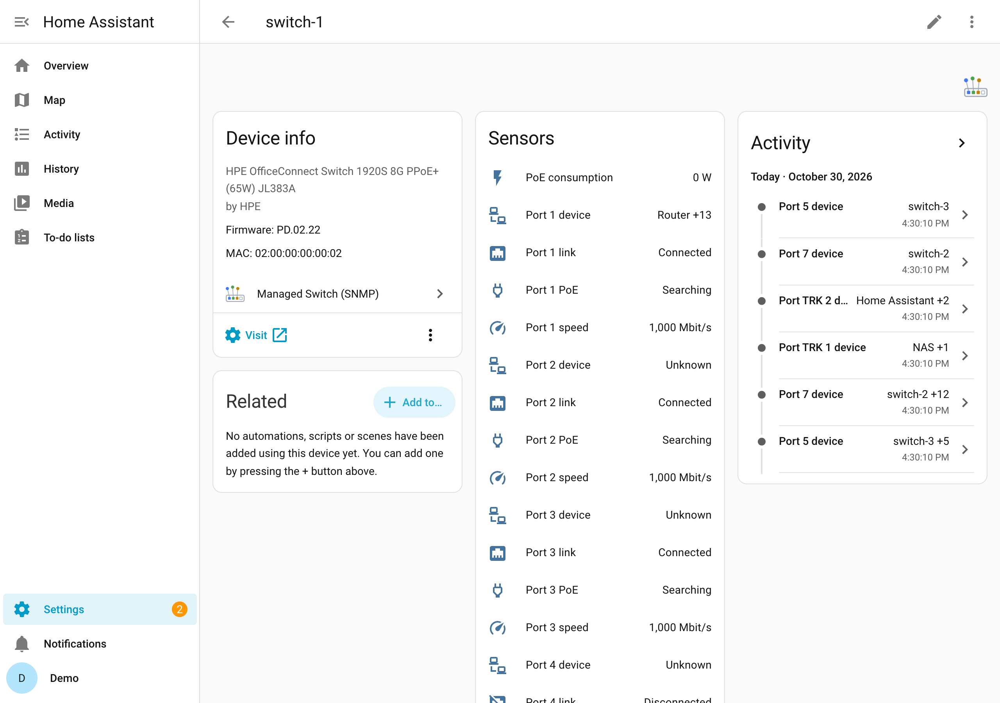

# Entities

## Per switch

| Entity | Meaning |
| --- | --- |
| Last restart | when the switch's SNMP agent started (diagnostic) |
| PoE budget | power the switch can deliver, watts (switches with PoE) |
| PoE consumption | power the powered devices draw, watts |
| Spanning tree changes | how often the topology changed since the restart (off by default) |
| Switch events | see [Events](events.md) |
| Temperature *name* | one per temperature sensor the switch reports, °C, named as the switch names it (for example *Temperature PHY*); switches with the ENTITY-SENSOR-MIB, and the HPE Instant On 1930 |

## Per port

Ports are the switch's Ethernet ports and its trunks (link aggregations) with members. Each
entity is named after the port as the switch names it, for example *Port 7 link* or *Port TRK 1
link* (in German *Port 7 Link*, *Port 7 Geschwindigkeit*, *Port 7 Gerät*; the entity IDs follow
the language Home Assistant used when they were created).

| Entity | Meaning |
| --- | --- |
| Port … link | on while the port has a link |
| Port … speed | link speed in Mbit/s, 0 without link |
| Port … device | what is connected: see below |
| Port … PoE | PoE state of the port: `disabled`, `searching`, `delivering_power`, `fault`, `test`, `other_fault`; attributes `enabled` and `power_class` (PoE ports only) |
| Port … received, sent | traffic in bit/s over the last polling interval (off by default; needs 64-bit counters) |
| Port … errors | received and sent errors since the restart (off by default) |

### Port … device

The state is the name of the device on the port; when there are several, the first name and how
many more (`Access point +8`). The attribute `devices` lists all of them with MAC address, name,
IP addresses (if a switch knows them) and whether the device announced itself by LLDP.

- An **LLDP neighbour** (another switch, an access point or phone that sends LLDP) comes first,
  by the name it announces.
- Other devices are named from Home Assistant's device registry: any device of another
  integration with that MAC address. Unknown devices show their MAC address.
- On a port with several devices, the one that names the port best comes first: the internet
  gateway (the router as the UPnP integration knows it), then a device the others are linked to
  in the registry (an access point whose integration links its clients to it), then the rest by
  name. So the port to your router shows `Router +13`, not the first client in the alphabet.
- Several devices on one port mean something is between: an access point with its Wi-Fi
  clients, a router, or an unmanaged switch.
- The links between your switches show the other switch, not everything behind it, as long as
  all switches are set up.

The sensor also carries `device_count`, the port's `port` name and `if_index` (to sort by), `link` (true or false) and `speed` (Mbit/s),
so a dashboard can show a whole port from this one entity. The device list, link and speed are
not recorded in this sensor's history (link and speed have their own entities).
