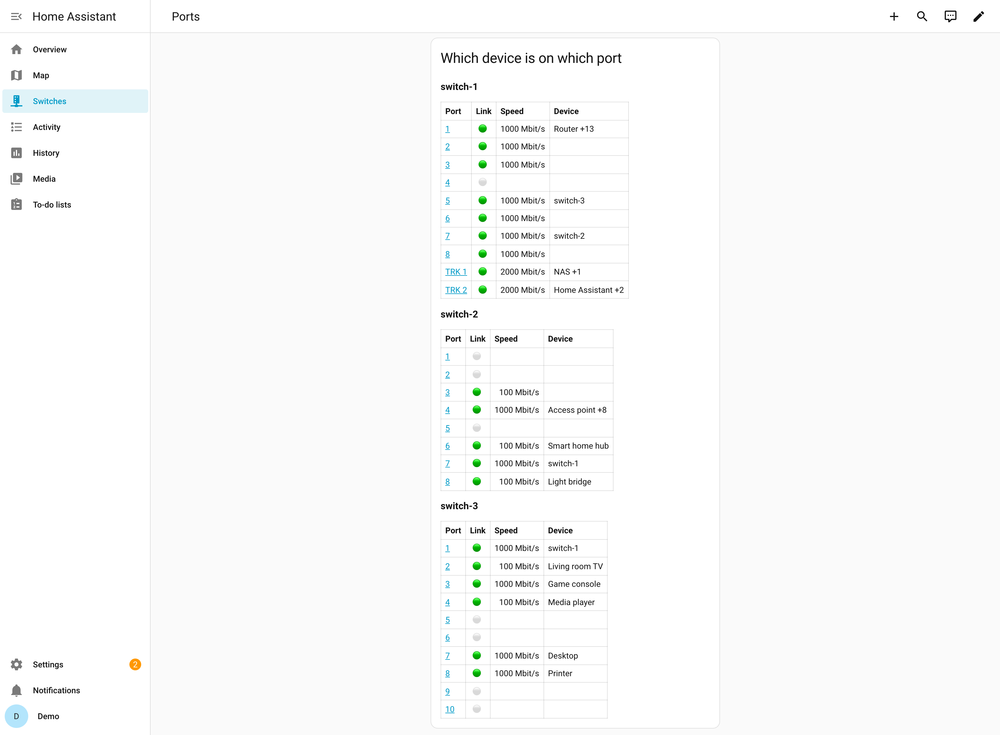

---
hide:
  - navigation
  - toc
---

Home Assistant · SNMP · read only

# Managed Switch

Every port of your <strong>managed switches</strong> in Home Assistant: link, speed, PoE, traffic, and which device is connected where, across all your switches.

[Install](installation.md){ .md-button .md-button--primary }
[Source on GitHub](https://github.com/eizedev/ha-managed-switch){ .md-button }

- [**Installation**](installation.md) HACS, then one entry per switch.
- [**Configuration**](configuration.md) SNMP access on the switch, setup, options.
- [**Entities**](entities.md) Switch and port sensors, what each means.
- [**Events**](events.md) Uplink down, slower port, restart, new device, with a blueprint.
- [**Dashboard**](dashboard.md) A port overview of all switches to paste.
- [**Ideas and automations**](ideas.md) Link lost, slow port, PoE, busy port: examples to copy.
- [**Troubleshooting**](troubleshooting.md) Timeouts, rejected users, missing ports.

## Before you start

- Home Assistant 2026.10.3 or newer.
- Read-only SNMP access on every switch (SNMPv3 recommended, v2c works): [SNMP access](configuration.md#snmp-access).
- LLDP on on every switch, and all switches added, so the links between them are recognised.
- Tested on HPE OfficeConnect 1920S and HPE Instant On 1930; other managed switches with the
  standard MIBs are expected to work. Reports are welcome in the
  [issues](https://github.com/eizedev/ha-managed-switch/issues) and
  [discussions](https://github.com/eizedev/ha-managed-switch/discussions).

## How it finds where a device is

Every switch learns the MAC addresses on its ports. The integration reads the address tables of
all your switches, recognises the links between them through LLDP, and places each device on the
one port that is not such a link. The name comes from Home Assistant's device registry: a device
that another integration (your router, a smart TV, a speaker) knows by its MAC address gets that
name. Details: [Locating devices](https://aiosnmpswitch.eize.dev/locating/) in the library's
documentation.

> Not affiliated with any switch vendor. Product names are trademarks of their owners.
